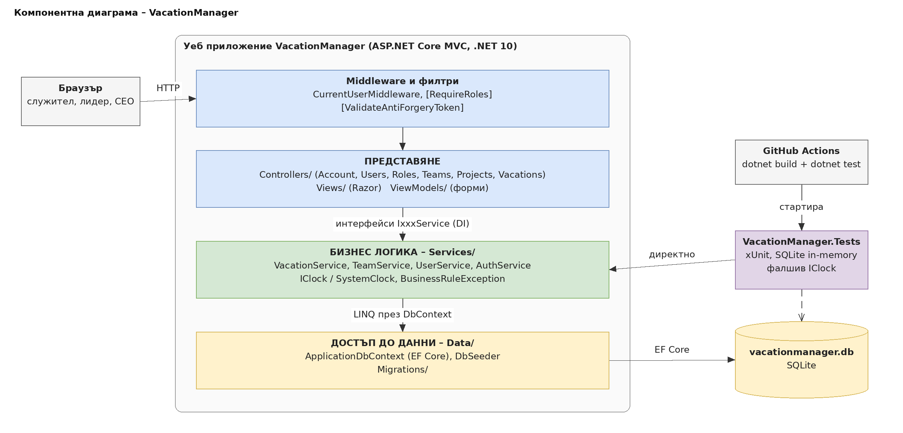
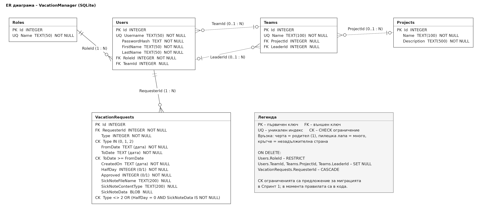
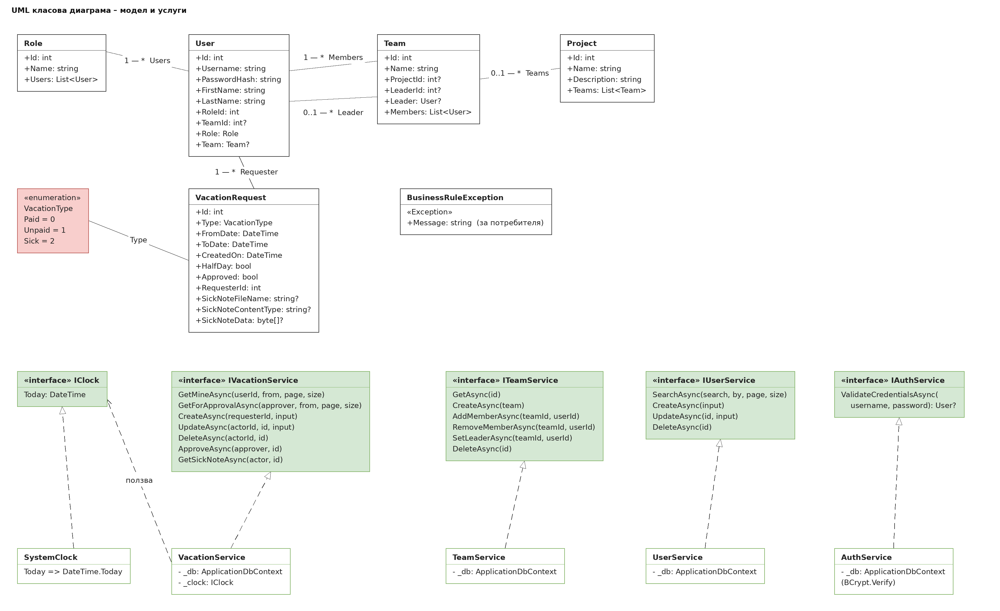

# Архитектура, модули и модел на данните – VacationManager

Екип: Здравко (Product Owner), Пейчев (Scrum Master), Виктор. Дата: 22.10.2026.

Документът описва как е устроено приложението отвътре: слоеве, модули, интерфейси, адреси и база данни. Изборът на технологии е в [01-избор-на-технологии.md](01-избор-на-технологии.md) и в [ADR файловете](adr/), а историите са в [беклога](../03-планиране/02-backlog.md). Диаграмите са в [diagrams/](diagrams/) като `.drawio` (за редактиране в draw.io) и `.png`.

> **Какво има в кода днес и какво е целта.** Сегашният код (Спринт 1) няма слой `Services/`: контролерите работят направо с `ApplicationDbContext` и съдържат бизнес правилата. Този документ описва **целевата** архитектура, към която преминаваме. Там, където днес е различно, е записано изрично. Преместването на правилата от контролерите в услуги е част от T-04 и от историите в Спринт 2 и 3.

## 1. Архитектурен стил и слоеве

VacationManager е клиент–сървър: клиентът е браузърът, а сървърът е ASP.NET Core MVC приложение, което връща готови HTML страници. Вътре сървърът е слоест – всеки слой ползва само слоя под себе си:

```
  Браузър
     │ HTTP GET/POST, HTML форми
     ▼
  ┌────────────────────────────────────────────────────────────────┐
  │ ФИЛТРИ      CurrentUserMiddleware, [RequireRoles]              │
  ├────────────────────────────────────────────────────────────────┤
  │ ПРЕДСТАВЯНЕ Controllers/  Views/  ViewModels/                  │
  ├────────────────────────────────────────────────────────────────┤
  │ БИЗНЕС      Services/: VacationService, TeamService,           │
  │ ЛОГИКА      UserService, AuthService, IClock                   │
  ├────────────────────────────────────────────────────────────────┤
  │ ДОСТЪП ДО   Data/: ApplicationDbContext, DbSeeder, Migrations/ │
  │ ДАННИ                                                          │
  └───────────────────────────────┬────────────────────────────────┘
                                  ▼
                       vacationmanager.db (SQLite)
```

Външна услуга няма (няма имейли и външно API – [ADR-006](adr/ADR-006-no-email-no-balance.md)), затова няма слой „външни услуги“, какъвто има в образеца. Тестовият проект `VacationManager.Tests` вика услугите директно, без браузър ([ADR-005](adr/ADR-005-testing-ci.md)).

Правила между слоевете:

1. **Контролерите не съдържат бизнес правила.** Те само приемат формата, проверяват `ModelState`, викат услуга и избират изглед или пренасочване. Контролер не използва `ApplicationDbContext`.
2. **Бизнес правилата (BR-01 – BR-10) са само в `Services/`.** При нарушение услугата хвърля `BusinessRuleException` със съобщение на български; контролерът го хваща и го добавя към `ModelState` или `TempData["Error"]`.
3. **Само `Services/` и `Data/` знаят за базата.** Изгледите получават модели и ViewModel-и, а не `DbContext`.
4. **Слоевете не викат нагоре:** услугите не знаят за `HttpContext`, а текущият потребител им се подава като параметър. Така могат да се тестват без уеб сървър.
5. **Времето идва само от `IClock`.** Никъде в услугите няма `DateTime.Today`, за да може тестът да „премести“ датата.
6. **Достъпът по роли е във филтъра `[RequireRoles]`** (кой има право да отвори страницата). Правилото „кой може да одобри точно тази заявка“ е бизнес правило и е в услугата (BR-05).
7. **Всяко действие, което променя данни, е POST със `[ValidateAntiForgeryToken]`.**

## 2. Бизнес правила

| ID | Правило | История | Къде е днес | Къде ще е |
|---|---|---|---|---|
| BR-01 | Крайната дата на заявката не е преди началната | US-10 | `VacationsController` | `VacationService` |
| BR-02 | Болничен отпуск няма половин ден | US-11 | `VacationsController` | `VacationService` |
| BR-03 | Болничен отпуск изисква прикачен файл | US-11 | `VacationsController` | `VacationService` |
| BR-04 | Заявката се редактира и трие само от собственика и само докато не е одобрена | US-12 | `VacationsController.CanModify` | `VacationService` |
| BR-05 | Одобрява само CEO или Team Lead от екипа на заявителя | US-13 | `VacationsController.ApproveRequest` | `VacationService.ApproveAsync` |
| BR-06 | Никой не одобрява собствената си заявка | US-13 | `VacationsController.ApproveRequest` | `VacationService.ApproveAsync` |
| BR-07 | Роля с назначени потребители не се трие | US-03 | `RolesController` | `UserService` (при US-03) |
| BR-08 | Лидерът на екип е член на екипа и има поне роля Team Lead | US-07 | `TeamsController.SetLeader` | `TeamService.SetLeaderAsync` |
| BR-09 | Потребителското име е уникално; имената на роли и екипи също | US-04, US-06 | `UsersController` и уникални индекси | `UserService`, `TeamService` и базата |
| BR-10 | Болничният файл се сваля само от собственика, CEO и лидера на екипа | US-11 | **липсва** (`DownloadNote` проверява само вход) | `VacationService.GetSickNoteAsync` |

BR-10 е известна слабост, записана в [ADR-004](adr/ADR-004-sick-note-storage.md): днес всеки влязъл служител може да свали чужд болничен, ако познае номера. Поправя се в Спринт 3 с US-11.

## 3. Модули и отговорности

Колоната „Отговорник“ следва разпределението на работата в екипа; ако матрицата RACI от урок 2 е различна, сменете имената тук.

| Модул | Отговорност | Интерфейс / ползва | Отговорник |
|---|---|---|---|
| Вход и достъп (`AccountController`, `AuthService`, `CurrentUserMiddleware`, `RequireRolesAttribute`) | вход, изход, хеширане с BCrypt, зареждане на текущия потребител, проверка на ролите | `IAuthService`; `ApplicationDbContext` | Пейчев |
| Потребители и роли (`UsersController`, `RolesController`, `UserService`) | CRUD на потребители, списък с роли; BR-07, BR-09 | `IUserService`; `ApplicationDbContext` | Виктор |
| Екипи и проекти (`TeamsController`, `ProjectsController`, `TeamService`) | CRUD, членове, лидер, свързване на екип с проект; BR-08 | `ITeamService`; `ApplicationDbContext` | Виктор |
| Отпуски (`VacationsController`, `VacationService`) | заявки, редакция, одобрение, болничен файл; BR-01 – BR-06, BR-10 | `IVacationService`; `ApplicationDbContext`, `IClock` | Здравко |
| Време (`SystemClock`) | днешната дата; подменя се в тестовете | `IClock` | Здравко |
| Данни (`ApplicationDbContext`, `DbSeeder`, `Migrations/`) | таблици, ключове, ограничения, начални данни | EF Core `DbContext` | Пейчев |
| Тестове и CI (`VacationManager.Tests`, GitHub Actions) | тестове на услугите с SQLite в паметта | `IClock` (фалшив) | Пейчев |

## 4. Интерфейси между модулите

Контролерите се пишат срещу интерфейса, а реализацията – от друг член на екипа. Общите типове:

```csharp
public record PagedResult<T>(List<T> Items, int Page, int PageSize, int TotalPages);

public class BusinessRuleException : Exception
{
    public BusinessRuleException(string message) : base(message) { }
}
```

Интерфейсите на основните модули:

```csharp
public interface IVacationService
{
    Task<PagedResult<VacationRequest>> GetMineAsync(int userId, DateTime? from, int page, int pageSize);
    Task<PagedResult<VacationRequest>> GetForApprovalAsync(User approver, DateTime? from, int page, int pageSize);
    Task<VacationRequest> CreateAsync(int requesterId, VacationInput input);   // BR-01, BR-02, BR-03
    Task UpdateAsync(int actorId, int requestId, VacationInput input);         // BR-04
    Task DeleteAsync(int actorId, int requestId);                              // BR-04
    Task ApproveAsync(User approver, int requestId);                           // BR-05, BR-06
    Task<SickNote> GetSickNoteAsync(User actor, int requestId);                // BR-10
}

public interface ITeamService
{
    Task<Team?> GetAsync(int id);
    Task<Team> CreateAsync(Team team);
    Task AddMemberAsync(int teamId, int userId);
    Task RemoveMemberAsync(int teamId, int userId);
    Task SetLeaderAsync(int teamId, int userId);                               // BR-08
    Task DeleteAsync(int id);
}

public interface IUserService
{
    Task<PagedResult<User>> SearchAsync(string? search, string? searchBy, int page, int pageSize);
    Task<User> CreateAsync(UserInput input);                                   // BR-09
    Task UpdateAsync(int id, UserInput input);                                 // BR-09
    Task DeleteAsync(int id);
}

public interface IAuthService
{
    Task<User?> ValidateCredentialsAsync(string username, string password);    // BCrypt.Verify
}

public interface IClock
{
    DateTime Today { get; }
}
```

`IClock` изглежда излишен, но позволява в тестовете да „преместим“ днешната дата и да проверим например заявка, създадена вчера, без да чакаме.

Регистрация в `Program.cs` (dependency injection):

```csharp
builder.Services.AddSingleton<IClock, SystemClock>();
builder.Services.AddScoped<IAuthService, AuthService>();
builder.Services.AddScoped<IUserService, UserService>();
builder.Services.AddScoped<ITeamService, TeamService>();
builder.Services.AddScoped<IVacationService, VacationService>();
```

Услугите са `Scoped`, защото ползват `ApplicationDbContext`, който е един на заявка. `SystemClock` няма състояние, затова е `Singleton`.

## 5. Адреси на приложението

Приложението връща HTML, не е REST API. Адресите са подредени по ресурси. Колоната „Достъп“ е записана с ролите от `[RequireRoles]`: „влязъл“ значи всеки влязъл потребител.

| Адрес | Метод | Действие | Достъп |
|---|---|---|---|
| `/` | GET | начална страница | всички |
| `/Account/Login` | GET, POST | форма за вход | всички |
| `/Account/Logout` | POST | изход | всички |
| `/Users?search=иван&searchBy=username&page=1&pageSize=10` | GET | списък със странициране и филтри | влязъл |
| `/Users/Details/1` | GET | детайли на потребител | влязъл |
| `/Users/Create`, `/Users/Edit/1` | GET, POST | форма за потребител | CEO |
| `/Users/Delete/1` | GET, POST | потвърждение и изтриване | CEO |
| `/Roles`, `/Roles/Details/1` | GET | роли и потребителите към тях | CEO |
| `/Roles/Create`, `/Roles/Edit/1` | GET, POST | форма за роля | CEO |
| `/Roles/Delete/1` | GET, POST | потвърждение и изтриване (BR-07) | CEO |
| `/Teams?search=…&searchBy=…`, `/Teams/Details/1` | GET | екипи и детайли | CEO |
| `/Teams/Create`, `/Teams/Edit/1` | GET, POST | форма за екип | CEO |
| `/Teams/Delete/1` | GET, POST | потвърждение и изтриване | CEO |
| `/Teams/AddMember/1`, `/Teams/RemoveMember/1`, `/Teams/SetLeader/1` | POST (`userId`) | членове и лидер (BR-08) | CEO |
| `/Projects?search=…`, `/Projects/Details/1` | GET | проекти и детайли | влязъл |
| `/Projects/Create`, `/Projects/Edit/1` | GET, POST | форма за проект | CEO |
| `/Projects/Delete/1` | GET, POST | потвърждение и изтриване | CEO |
| `/Projects/AddTeam/1`, `/Projects/RemoveTeam/1` | POST (`teamId`) | екипи към проект | влязъл (по код днес; трябва CEO) |
| `/Vacations?from=2026-11-01` | GET | моите заявки | влязъл |
| `/Vacations/Create` | GET, POST | нова заявка (платен, неплатен, болничен) | влязъл |
| `/Vacations/Edit/1`, `/Vacations/Delete/1` | GET, POST | редакция и триене на неодобрена заявка (BR-04) | влязъл, само собственик |
| `/Vacations/Approve` | GET | заявки за одобрение | CEO, Team Lead |
| `/Vacations/ApproveRequest/1` | POST | одобряване (BR-05, BR-06) | CEO, Team Lead |
| `/Vacations/DownloadNote/1` | GET | сваляне на болничен файл (BR-10) | влязъл (по код днес; трябва собственик, CEO, лидер) |

Действията, които променят данни, са POST. Страниците `Delete` са GET само за потвърждението; самото изтриване е POST със защита срещу фалшиви заявки.

Два реда в таблицата показват несъответствие между кода и целта: `AddTeam`/`RemoveTeam` в `ProjectsController` са достъпни за всеки влязъл (в класа е `[RequireRoles]` без роли, а CEO е само на Create, Edit и Delete), а `DownloadNote` не проверява собственика (BR-10). И двата се поправят в Спринт 2 и 3.

## 6. Модел на данните

Същности: роля, потребител, екип, проект и заявка за отпуск. Връзките:

- Роля 1 – N Потребител (всеки потребител има точно една роля).
- Екип 1 – N Потребител като членове (потребителят е най-много в един екип).
- Екип N – 0..1 Потребител като лидер (отделна връзка към същата таблица).
- Проект 1 – N Екип (екипът има най-много един проект).
- Потребител 1 – N Заявка за отпуск.

**Как е реализирана връзката много към много.** В тази версия няма връзка много към много: екипът има най-много един проект, а потребителят – най-много един екип, затова всяка връзка е „едно към много“ с външен ключ в страната „много“. Ако по-късно потребител трябва да е в няколко екипа, `Users.TeamId` се заменя със свързваща таблица `TeamMembers (TeamId, UserId)` със съставен първичен ключ – точно както `Loans` свързва книги и читатели в образеца.

Колоните и ограниченията (всяко UNIQUE, CHECK и FK е свързано с правило или история). Колоната „Статус“ показва дали ограничението е в сегашната миграция `InitialCreate`:

| Таблица | Колона | Тип | Ограничение | Правило / история | Статус |
|---|---|---|---|---|---|
| Roles | Id | INTEGER | PK, автоматичен | – | има |
| Roles | Name | TEXT(50) | NOT NULL, UNIQUE | BR-09, US-02 | има |
| Users | Id | INTEGER | PK, автоматичен | – | има |
| Users | Username | TEXT(50) | NOT NULL, UNIQUE | BR-09, US-01, US-04 | има |
| Users | PasswordHash | TEXT | NOT NULL | NFR-03, [ADR-003](adr/ADR-003-authentication.md) | има |
| Users | FirstName, LastName | TEXT(50) | NOT NULL | US-04 | има |
| Users | RoleId | INTEGER | NOT NULL, FK → Roles.Id, ON DELETE RESTRICT | BR-07, US-14 | има |
| Users | TeamId | INTEGER | NULL, FK → Teams.Id, ON DELETE SET NULL | US-07: триенето на екип не трие хората | има |
| Teams | Id | INTEGER | PK, автоматичен | – | има |
| Teams | Name | TEXT(100) | NOT NULL, UNIQUE | BR-09, US-06 | има |
| Teams | ProjectId | INTEGER | NULL, FK → Projects.Id, ON DELETE SET NULL | US-08 | има |
| Teams | LeaderId | INTEGER | NULL, FK → Users.Id, ON DELETE SET NULL | BR-08, US-07 | има |
| Projects | Id | INTEGER | PK, автоматичен | – | има |
| Projects | Name, Description | TEXT(100), TEXT(500) | NOT NULL | US-08 | има |
| VacationRequests | Id | INTEGER | PK, автоматичен | – | има |
| VacationRequests | RequesterId | INTEGER | NOT NULL, FK → Users.Id, ON DELETE CASCADE | US-10; изтриването на потребител трие заявките му | има |
| VacationRequests | Type | INTEGER | NOT NULL, CHECK Type IN (0, 1, 2) | US-10, US-11 (0 платен, 1 неплатен, 2 болничен) | **нов** |
| VacationRequests | FromDate, ToDate | TEXT (дата) | NOT NULL, CHECK ToDate >= FromDate | BR-01 | CHECK е **нов** |
| VacationRequests | CreatedOn | TEXT (дата) | NOT NULL | US-10 | има |
| VacationRequests | HalfDay, Approved | INTEGER (0/1) | NOT NULL | BR-02, BR-05 | има |
| VacationRequests | SickNoteFileName, SickNoteContentType | TEXT(200) | NULL | BR-03, [ADR-004](adr/ADR-004-sick-note-storage.md) | има |
| VacationRequests | SickNoteData | BLOB | NULL; CHECK Type <> 2 OR (HalfDay = 0 AND SickNoteData IS NOT NULL) | BR-02, BR-03 | CHECK е **нов** |

Новите CHECK ограничения са предложение за миграцията в Спринт 1 (T-02). Правилата остават и в услугите, защото базата дава само общо съобщение за грешка, а потребителят трябва да види обяснение на български. Датите в SQLite се пазят като текст.

## 7. Диаграми

Изходните файлове са в [diagrams/](diagrams/); отворете `.drawio` в app.diagrams.net за редактиране.

**Компонентна диаграма** ([components.drawio](diagrams/components.drawio)) – браузър, слоевете на уеб приложението, базата, тестовият проект и CI.



**ER диаграма** ([er.drawio](diagrams/er.drawio)) – таблици с PK, FK, UQ и CK и кратност на връзките.



**UML класова диаграма** ([classes.drawio](diagrams/classes.drawio)) – класовете на модела, интерфейсите на услугите и реализациите им (пунктирана стрелка с празен триъгълник).



## 8. Къде стои кодът на всеки

| Член | Работи в папки | Диаграма |
|---|---|---|
| Здравко | `Services/VacationService.cs`, `Services/SystemClock.cs`, `Controllers/VacationsController.cs`, `Views/Vacations/` | компонент „Бизнес логика“, класове `VacationService`, `SystemClock` |
| Пейчев | `Services/AuthService.cs`, `Middleware/`, `Attributes/`, `Data/`, `Migrations/`, `VacationManager.Tests/` | компоненти „Филтри“, „Достъп до данни“, „Тестове“; таблици в ER |
| Виктор | `Services/UserService.cs`, `Services/TeamService.cs`, `Controllers/` (Users, Roles, Teams, Projects), `Views/` за тях | компонент „Бизнес логика“, класове `UserService`, `TeamService` |

**В кой слой са бизнес правилата?** В слоя „Бизнес логика“ (`Services/`). Контролерите само приемат формата и избират изглед, а базата пази само ключовете и уникалността.
