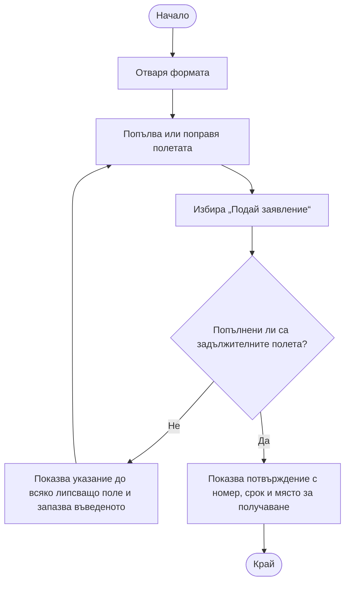
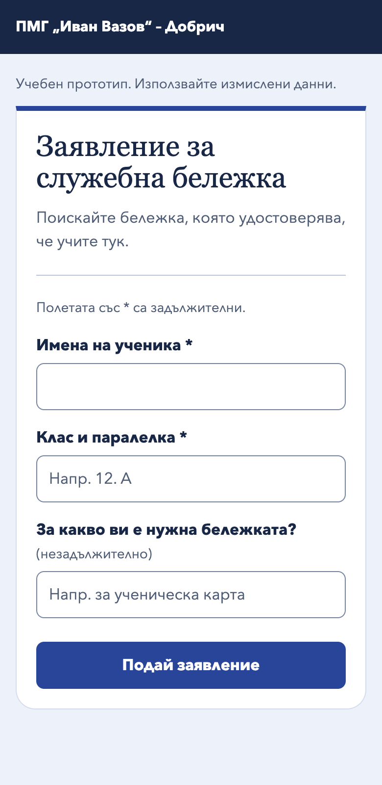
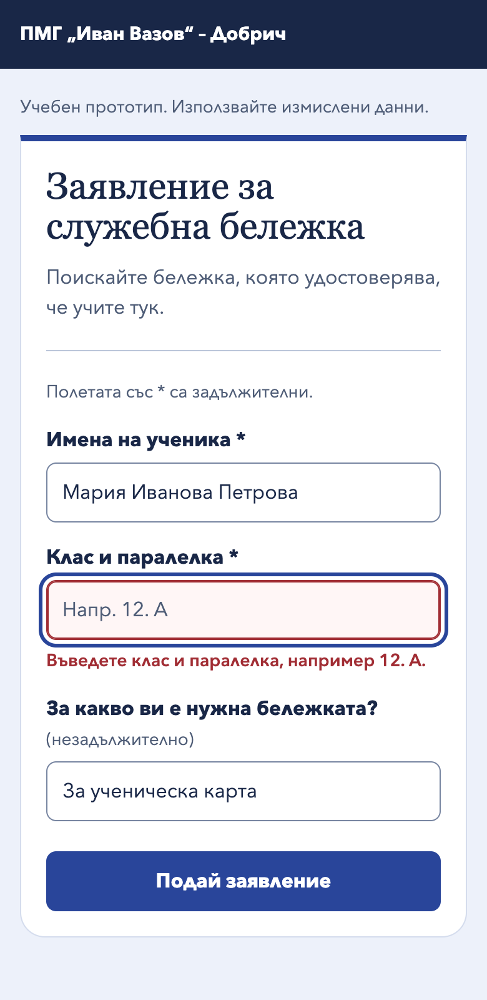
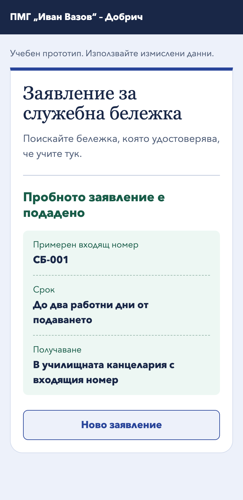

# Работен лист – Подаване на заявление

ПМГ „Иван Вазов“ – Добрич · Софтуерно инженерство · 12. клас

Екип **Здравко, Пейчев, Виктор** · 12.11.2026 г.

## 1. Екип и роли

Предложено разпределение за представянето и теста.

| Роля | Име | Задача |
|---|---|---|
| Водещ и тестер | Здравко | Представя казуса, проверява критериите и записва наблюденията от теста. |
| Дизайнер на потока | Пейчев | Представя потока и връщането към формата след грешка. |
| Дизайнер на екраните | Виктор | Демонстрира трите състояния и обяснява текстовете на формата. |

## 2. Казус

**Заявление за служебна бележка**, която удостоверява, че ученикът учи в ПМГ „Иван Вазов“. Ученикът подава заявлението от браузъра на телефона си. Примерна цел е издаване на ученическа карта за транспорт.

| Поле | Задължително | Пример |
|---|---|---|
| Имена на ученика | Да | Мария Иванова Петрова |
| Клас и паралелка | Да | 12. А |
| За какво ви е нужна бележката? | Не | За ученическа карта |

## 3. Допускания

| № | Допускане | Как ще го проверим |
|---|---|---|
| 1 | Имената и паралелката са достатъчни, за да намери канцеларията ученика. | Питаме служител как би проверил заявка и какво прави при съвпадащи имена. |
| 2 | Причината за заявката е полезна, но може да се пропусне. | Проверяваме с канцеларията дали издава бележката, ако това поле е празно. |
| 3 | Учениците могат сами да попълнят формата от телефон и да поправят пропуснато поле. | Наблюдаваме ученик от друг екип по протокола в раздел 7. |
| 4 | Бележката може да се получи в канцеларията до два работни дни с входящ номер. | Потвърждаваме с канцеларията срока, мястото и дали е нужен номерът при получаване. |

## 4. Поток за подаване на заявление

## 5. Три екрана

Отворете [интерактивния прототип](prototype/index.html) в браузър от локално копие на хранилището. За пробата използвайте измислени данни. Подаването се симулира, а номерът и срокът са примерни.

| Празно | Грешка | Успех |
|---|---|---|
|  |  |  |
| Етикетите и примерът за паралелка дават насока още преди въвеждането. | Ученикът вижда какво да поправи, без да пише отново вече въведените данни. | Номерът, срокът и мястото помагат на ученика да планира получаването. |

## 6. Критерии за готов резултат

| Критерий | Да | Не | Проверка |
|---|:---:|:---:|---|
| Потокът има начало, край, решение и връщане към формата при грешка. | ✓ | | Раздел 4. |
| Една и съща форма има празно, грешно и успешно състояние. | ✓ | | Трите екрана в раздел 5. |
| Всяка грешка посочва полето и как да се поправи. | ✓ | | Проверени са и двете задължителни полета. |
| Успешният екран показва номер, срок и място за получаване. | ✓ | | Потвърждението в раздел 5. |
| Проведен е тест с ученик от друг екип и наблюденията са записани. | | ✓ | Предстои. |
| При грешка всички вече въведени стойности остават във формата. | ✓ | | След пропуснат клас остават имената и причината. |

Проверихме в Chrome подаване с грешка, поправка, успешно подаване, ново заявление и работа с клавиатура.

## 7. Кратък тест с друг ученик

Тестерът дава задачата дословно и моли участника да мисли на глас. Засича времето от отварянето на празната форма до обяснението как ще получи бележката. Наблюдава без подсказки и попълва протокола след теста.

| Протокол | Запис |
|---|---|
| Участник | ……………………………… (ученик от друг екип) |
| Задача | „Поискай служебна бележка за ученическа карта. Използвай примерното име Мария Иванова Петрова. При първия опит остави класа празен. Ако формата поиска още данни, твоят клас е 12. А. Накрая кажи как ще получиш бележката.“ |
| Време за изпълнение | ……………………………… |
| Резултат | ☐ Справи се сам · ☐ Справи се с помощ · ☐ Не се справи |

| Какво се случи | Какво променяме |
|---|---|
| ……………………………… | ……………………………… |
| ……………………………… | ……………………………… |
| ……………………………… | ……………………………… |

## 8. Представяне

| Време | Кой представя | Съдържание |
|---|---|---|
| 0:00–0:40 | Здравко | Казусът, полетата и допусканията. |
| 0:40–1:25 | Пейчев | Потокът и връщането към формата след пропуск. |
| 1:25–2:45 | Виктор и Здравко | Виктор показва подаване с пропуснат клас и после успешен опит. Здравко представя наблюденията, ако тестът е проведен, и завършва с риска и предложението за подобрение. |

**Риск.** Ученикът може да отиде в канцеларията твърде рано, ако приеме примерния срок за потвърден от училището.

**Подобрение.** След уточняване на процеса с канцеларията добавяме статус „Готова за получаване“, за да спестим излишно посещение.

## 9. Оценяване от учителя

| Критерий | Индикатор | Макс. | Точки |
|---|---|---:|---|
| Коректност | Понятията и връзките са използвани правилно, а потокът и състоянията са верни. | 4 | |
| Пълнота | Решението покрива задачата и може да бъде проверено. | 3 | |
| Аргументация | Изборите са обяснени чрез стойност, риск и качество. | 2 | |
| Екипна работа | Ролите и приносът са видими. | 1 | |
| **Общо** | | **10** | |
